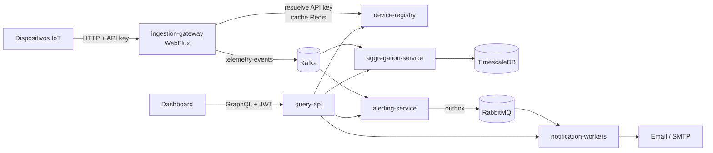

# PulseGrid

Plataforma de telemetría IoT con alertas en tiempo real, construida como **6 microservicios Spring Boot** en arquitectura hexagonal. Los dispositivos envían lecturas constantemente; la plataforma las ingiere, las agrega en series de tiempo, evalúa reglas de alerta y notifica por email. Un dashboard consulta todo por GraphQL.

Una lectura de sensor que rompe una regla se convierte en un email de alerta **en ~3 segundos**, de punta a punta.

**Stack:** Java 21 · Spring Boot 3.5 · Apache Kafka · RabbitMQ · Spring WebFlux · Spring for GraphQL · PostgreSQL · TimescaleDB · Redis · Resilience4j · Docker · Kubernetes · GitHub Actions · JUnit 5 · Mockito · Testcontainers

## Arquitectura



- **Escritura de telemetría (asíncrona):** el gateway responde `202 Accepted` sin esperar al resto; Kafka desacopla la ingesta del procesamiento y particiona por dispositivo para conservar el orden.
- **Alertas (asíncrona):** alerting publica a RabbitMQ mediante *transactional outbox*, y los workers consumen como *competing consumers*.
- **Lectura (síncrona):** el dashboard habla solo con `query-api`, que compone los datos de los demás servicios (*API Composition*, lado de lectura de CQRS). Los comandos van por REST directo al servicio dueño de cada entidad.

## Microservicios

| Servicio | Puerto | Responsabilidad | Tecnologías clave |
|---|---|---|---|
| [`device-registry`](backend/device-registry/README.md) | 8090 | CRUD de dispositivos y grupos, API keys, login del dashboard (JWT) | Spring Security, JPA, Flyway |
| `ingestion-gateway` | 8091 | Ingesta reactiva de telemetría autenticada por API key | WebFlux, reactor-kafka, Redis |
| `aggregation-service` | 8092 | Agregados por minuto en series de tiempo; lectura interna para query-api | Kafka consumer, TimescaleDB (continuous aggregates) |
| `alerting-service` | 8093 | Reglas de alerta, evaluación de eventos y publicación de alertas | Kafka consumer, RabbitMQ producer, outbox, publisher confirms |
| [`notification-workers`](backend/notification-workers/README.md) | 8094 | Envío de emails idempotente y resiliente | RabbitMQ consumer, DLQ, Resilience4j |
| [`query-api`](backend/query-api/README.md) | 8095 | API GraphQL de solo lectura para el dashboard | Spring for GraphQL, DataLoader, token relay |

Cada servicio tiene su propia base de datos, Dockerfile, manifiestos de Kubernetes y pipeline de CI/CD.

## Decisiones de diseño destacadas

- **Ingesta no bloqueante** con WebFlux: miles de dispositivos concurrentes con pocos hilos y *backpressure*.
- **Sin doble escritura:** alerting guarda la alerta y el mensaje a publicar en la misma transacción (*transactional outbox*) y confirma la entrega con *publisher confirms*.
- **Consumidor idempotente:** los workers registran cada alerta procesada, así un mensaje reentregado no envía un email duplicado.
- **Fallos del mundo vs. mensajes rotos:** si el SMTP cae, un *circuit breaker* pausa el consumo y los mensajes esperan en la cola; si el mensaje es inválido, va a la *dead-letter queue* tras reintentos.
- **GraphQL sin N+1:** los campos que dependen de otro servicio se cargan en lote con DataLoader; si un servicio cae, la respuesta llega con **datos parciales** y el error en `errors`.
- **Kubernetes:** requests/limits, startup/liveness/readiness probes, *graceful shutdown* y autoescalado HPA.

## Cómo correrlo

Requisitos: Docker y Docker Compose.

```bash
docker compose up -d --build
```

Levanta los 6 microservicios y su infraestructura (PostgreSQL ×3, TimescaleDB, Kafka, RabbitMQ, Redis, Mailpit).

| Recurso | URL |
|---|---|
| Swagger de device-registry | http://localhost:8090/swagger-ui/index.html |
| GraphiQL (query-api) | http://localhost:8095/graphiql |
| RabbitMQ Management | http://localhost:15672 |
| Mailpit (emails enviados) | http://localhost:8025 |

### Flujo de prueba

1. **Login** en device-registry: `POST /api/v1/auth/login` → JWT.
2. **Registrar un dispositivo**: `POST /api/v1/devices` → devuelve su API key.
3. **Crear una regla de alerta** en alerting-service: `POST /api/v1/alert-rules` (por ejemplo, temperatura mayor a 80).
4. **Enviar telemetría** al gateway: `POST /api/v1/telemetry` con el header `X-Api-Key`.
5. Ver el **email de alerta** en Mailpit y consultar todo desde **GraphiQL** con el JWT en la pestaña *Headers*.

El detalle de cada endpoint está en Swagger y en el README de cada servicio.

## Tests y CI/CD

```bash
cd backend/<servicio>
./mvnw verify
```

- **Unitarios** con JUnit 5 y Mockito.
- **Integración** con Testcontainers (PostgreSQL, TimescaleDB, Kafka, RabbitMQ y Mailpit reales).
- **Capa API** con `@WebMvcTest`, `WebTestClient` y `GraphQlTester`.

Cada servicio tiene su workflow de **GitHub Actions** (`.github/workflows/`): build y tests en cada PR; en `main`, además, build y push de la imagen Docker.

## Estructura

```
backend/
  <servicio>/
    src/main/java/.../
      domain/          entidades y reglas de negocio
      application/     casos de uso y puertos (in/out)
      infrastructure/  adaptadores: persistencia, mensajería, clientes REST, seguridad
      api/             adaptadores de entrada: REST / GraphQL
    k8s/               manifiestos de Kubernetes
    Dockerfile
docker-compose.yml
.github/workflows/     un pipeline por servicio
```
